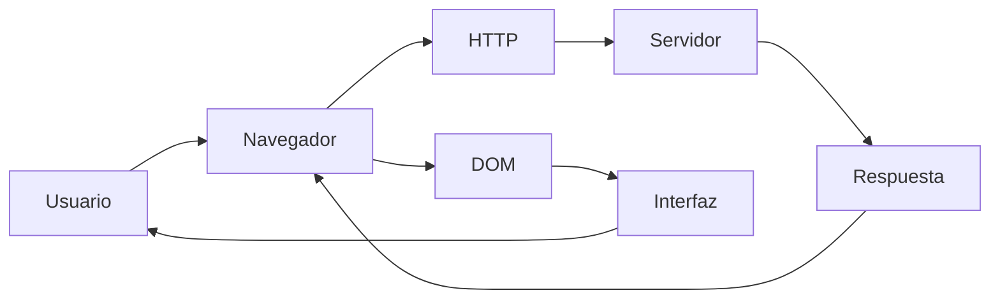
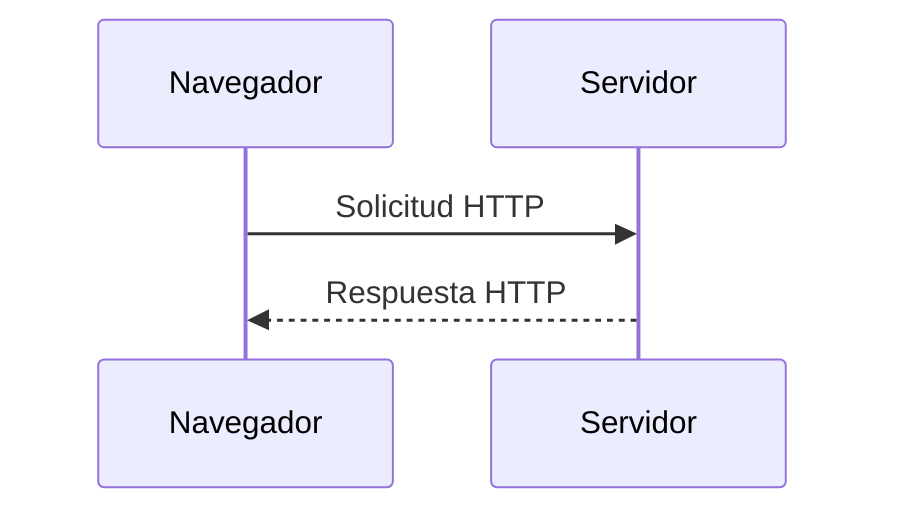
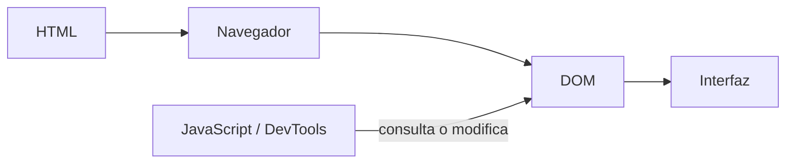
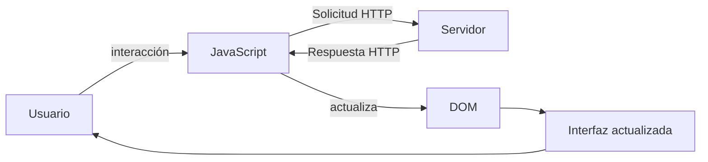
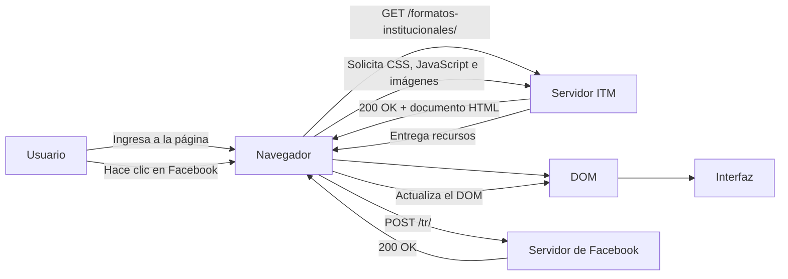

# Laboratorio 01 --- Análisis del funcionamiento de una aplicación web

> **Curso:** Aplicaciones y Servicios Web\
> **Modalidad:** Práctica de laboratorio\
> **Entrega:** Repositorio GitHub --- archivo `README.md`\
> **Evidencias:** Carpeta `evidencias/`

------------------------------------------------------------------------

## Objetivo de la práctica

Analizar el funcionamiento de una aplicación web real mediante las
herramientas de desarrollo del navegador, identificando los recursos
cargados, las solicitudes y respuestas HTTP, la estructura DOM y las
interacciones entre cliente y servidor.

## Resultado esperado

Al finalizar la práctica, el estudiante deberá poder reconstruir y
documentar el flujo observado entre:



> El diagrama anterior representa los **componentes que serán
> analizados**. El diagrama final de la práctica deberá ser construido
> por el estudiante a partir de sus propias observaciones.

------------------------------------------------------------------------

# 1. Preparación del entorno

1.  Ingrese a la aplicación web indicada por el docente.
2.  Abra las **herramientas de desarrollo** del navegador.
3.  Identifique las herramientas **Red / Network** y **Elementos /
    Elements**.
4.  Cree la siguiente estructura dentro del repositorio:

``` text
laboratorio-01/
├── README.md
└── evidencias/
```

El archivo `README.md` será el informe de la práctica. La carpeta
`evidencias/` contendrá las capturas utilizadas para sustentar los
resultados.

------------------------------------------------------------------------

# 2. Identificación de recursos de la aplicación

Abra la herramienta **Red / Network** y recargue completamente la
aplicación.

Observe las solicitudes generadas durante la carga e identifique como
mínimo **cinco recursos**, procurando seleccionar tipos diferentes:
documento HTML, CSS, JavaScript, imágenes, fuentes u otros.

## Resultados

Complete la tabla:

  Recurso                            Tipo       Dominio                 Tamaño
  ---------                         ------     ---------               --------
  jquery-ui.min.css?ver=1.047      Stylesheet  www.itm.edu.co         (Memory cache)    
  jquery.min.js?ver=3.7.1           Script     www.itm.edu.co         (Memory cache)                          
  leaf_icon1.png                     png       www.itm.edu.co         (Memory cache)
  formatos-institucionales/          HTML      www.itm.edu.co             93.3kB
  fa-brands-400.woff2                Font      use.fontawesome.com    (Memory cache)

**Total de solicitudes observadas:** `_151____`

## Evidencia

Guarde una captura de la pestaña Network como:

``` text
evidencias/network.png
```

Inclúyala aquí:

``` markdown

```

### Análisis

**¿Por qué una sola URL puede generar múltiples solicitudes HTTP?**

> Escriba aquí su respuesta.
Porque la página web está compuesta por diferentes recursos y el navegador
debe solicitar cada uno de esos recursos al servidor para poder mostrar
los resultados.
------------------------------------------------------------------------

# 3. Análisis de una solicitud HTTP

En **Network**, seleccione una de las solicitudes realizadas por el
navegador, preferiblemente la correspondiente al documento principal.

Identifique la información solicitada a continuación.

  Elemento              Resultado
  --------------------- -----------
  URL                   https://www.itm.edu.co/formatos-institucionales/
  Método HTTP           GET
  Código de estado      200 OK
  Host / dominio        www.itm.edu.co
  Tipo de recurso       document
  Tiempo de respuesta   1.32 s

## Flujo que se está observando



## Evidencia

Guarde una captura de los detalles de la solicitud como:

``` text
evidencias/request.png
```

Inclúyala en el informe:

``` markdown

```

### Análisis

**¿Qué recurso solicitó el navegador?**

> Escriba aquí su respuesta.
El navegador solicitó el documento HTML principal de la página
del sitio web del ITM 
------------------------------------------------------------------------

**¿Qué información permite determinar si la solicitud fue atendida
correctamente?**

> Escriba aquí su respuesta.
La información que permite determinar si la solicitud fue atendida 
correctamente es principalmente el código de estado HTTP
------------------------------------------------------------------------

# 4. Inspección del DOM

Seleccione un elemento visible de la aplicación, por ejemplo:

-   un botón;
-   un título;
-   un enlace;
-   un campo de formulario;
-   un elemento del menú.

Utilizando **Elementos / Elements**:

1.  Localice el elemento dentro del DOM.
2.  Identifique la etiqueta HTML utilizada.
3.  Modifique temporalmente su contenido desde las herramientas de
    desarrollo.
4.  Observe el cambio producido en la interfaz.
5.  Registre la evidencia.

## Resultados

**Elemento seleccionado:** `Título: Formatos Institucionales`

**Etiqueta HTML:** `h1`

**Contenido original:** `Formatos Institucionales`

**Modificación realizada:** `Se cambió temporalmente el texto: Formatos Institucionales por: Laboratorio web 01`

El proceso observado puede representarse conceptualmente así:



## Evidencia

Guarde la captura como:

``` text
evidencias/dom.png
```

Inclúyala aquí:

``` markdown

```

### Análisis

**¿La modificación realizada sobre el DOM alteró permanentemente la
aplicación o los archivos almacenados en el servidor? Justifique.**

> Escriba aquí su respuesta.
No, la modificación no alteró permanentemente la aplicación ni los archivos almacenados 
en el servidor. El cambio se realizó directamente sobre el DOM mediante las herramientas
 de desarrollo del navegador, por lo que solamente modificó temporalmente la representación 
 de la página en el navegador del usuario. Al recargar la página, el cambio desaparece porque
  el navegador vuelve a solicitar los archivos originales al servidor.
------------------------------------------------------------------------

# 5. Análisis de una interacción dinámica

Regrese a **Network** y limpie las solicitudes registradas.

Realice una acción dentro de la aplicación que pueda generar una
interacción con el servidor, por ejemplo:

-   consultar;
-   buscar;
-   filtrar;
-   seleccionar una opción;
-   enviar información.

Observe si aparece una nueva solicitud en Network.

## Resultados

  Elemento                       Resultado
  ------------------------------ -----------
  Acción realizada               Clic sobre el enlace de Facebook
  ¿Generó una nueva solicitud?   Si
  URL solicitada                 https://www.facebook.com/tr/
  Método HTTP                    POST
  Código de estado               200 OK
  Tipo de respuesta              fetch

## Ciclo de interacción

Utilice este esquema únicamente como referencia conceptual para
interpretar lo observado:



## Evidencia

Guarde la captura como:

``` text
evidencias/interaccion.png
```

Inclúyala aquí:

``` markdown

```

### Análisis

**Explique la relación entre la acción realizada por el usuario y la
solicitud observada.**

> Escriba aquí su respuesta.
La acción realizada por el usuario, en este caso hacer clic sobre el enlace de Facebook, 
provocó una interacción del navegador con un servidor externo. Como resultado, se generó 
una solicitud HTTP mediante el método POST hacia https://www.facebook.com/tr/. El servidor 
respondió con el código 200 OK, indicando que la solicitud fue procesada correctamente
------------------------------------------------------------------------

# 6. Reconstrucción del flujo observado

A partir de **sus propias evidencias**, construya un diagrama Mermaid
que represente el funcionamiento de la aplicación analizada.

El diagrama deberá incluir, cuando corresponda:

`Usuario` · `Navegador` · `JavaScript` · `Solicitud HTTP` · `Servidor` ·
`Respuesta HTTP` · `DOM` · `Interfaz`

> **No copie los diagramas anteriores.** Esta sección debe representar
> el flujo que usted pudo comprobar durante la práctica.

Reemplace el siguiente bloque con su diagrama:



------------------------------------------------------------------------

# 7. Observado vs. inferido

Una herramienta de desarrollo permite observar una parte del sistema,
pero no necesariamente todo lo que ocurre en el servidor.

Clasifique sus hallazgos:

## Elementos observados directamente

- El navegador realizó una solicitud GET a `https://www.itm.edu.co/formatos-institucionales/` y recibió el código `200 OK`.
- Se observaron diferentes recursos cargados por la aplicación, como documentos HTML, archivos CSS, JavaScript e imágenes.
- Al modificar un elemento desde la herramienta Elements, el contenido cambió temporalmente en la interfaz y desapareció al recargar la página. 

## Elementos inferidos

- Se infiere que el servidor del ITM procesa las solicitudes y genera o entrega los recursos solicitados por el navegador
- Se infiere que el navegador utiliza el documento HTML, CSS y JavaScript recibidos para construir y actualizar la interfaz mediante el DOM 
- Se infiere que la solicitud a Facebook corresponde a algún proceso de comunicación o registro asociado con la interacción realizada, aunque su procesamiento interno no puede comprobarse directamente desde las herramientas del navegador.  

> No presente como observado un proceso interno que las herramientas del
> navegador no permitan comprobar directamente.

------------------------------------------------------------------------

# 8. Conclusiones

Redacte **tres conclusiones técnicas** derivadas de la práctica.

1. El funcionamiento de una aplicación web depende de múltiples recursos y solicitudes HTTP. Durante 
la práctica se comprobó que una sola página puede generar numerosas solicitudes para obtener documentos 
HTML, archivos CSS, JavaScript, imágenes y otros recursos necesarios para construir la interfaz.

2. Las herramientas de desarrollo permiten analizar directamente la comunicación entre el navegador y los 
servidores. La observación de solicitudes como GET y POST, junto con códigos de estado como 200 OK, permitió
 comprender cómo las acciones del usuario pueden generar comunicaciones con el servidor y cómo el navegador 
 recibe las respuestas correspondientes.

3. El DOM representa la interfaz que el navegador construye a partir de los recursos recibidos,
 pero las modificaciones realizadas desde Elements son únicamente locales y temporales. Esto permitió 
 diferenciar entre los cambios que pueden observarse directamente en el navegador y los procesos internos
  del servidor que no pueden comprobarse mediante las herramientas de desarrollo.

Las conclusiones deben explicar lo aprendido a partir de la evidencia y
no limitarse a describir las actividades realizadas.

------------------------------------------------------------------------

# 9. Entrega

La estructura final esperada es:

``` text
laboratorio-01/
├── README.md
└── evidencias/
    ├── network.png
    ├── request.png
    ├── dom.png
    └── interaccion.png
```

Antes de entregar, verifique:

-   [ ] El `README.md` se visualiza correctamente en GitHub.
-   [ ] Las imágenes se muestran dentro del README.
-   [ ] Se documentaron al menos cinco recursos.
-   [ ] Se analizó una solicitud HTTP.
-   [ ] Se identificó y modificó un elemento del DOM.
-   [ ] Se analizó una interacción de la aplicación.
-   [ ] El diagrama final corresponde a lo observado.
-   [ ] Se diferenciaron elementos observados e inferidos.
-   [ ] Se redactaron tres conclusiones técnicas.
-   [ ] Se realizó `commit` y `push` al repositorio.

------------------------------------------------------------------------

## Criterio de documentación

> **Las capturas son evidencia, no la respuesta.**

Cada evidencia debe estar acompañada por una explicación que indique
**qué se observó, qué significa y cómo se relaciona con el
funcionamiento de la aplicación web**.
